# Cattle Muzzle Groove Extraction & Ridge Skeletonization System

An advanced computer vision pipeline for extracting dermatoglyphic dark groove lines, bead boundary valleys, and topological ridge centerlines from cattle muzzle videos and images.

---

## 1. System Overview

Cattle muzzle prints (dermatoglyphic patterns) are unique biometrics analogous to human fingerprints. Each muzzle features distinct epidermal beads separated by dark, interconnected grooves.

This project implements an end-to-end image processing architecture that:
1. Ingests raw cattle videos or high-resolution images.
2. Identifies and extracts pristine cattle muzzle regions using Mask R-CNN instance segmentation.
3. Suppresses surrounding background, hair texture, and dark nostril breathing cavities.
4. Enhances dermatoglyphic groove valleys using multi-scale morphological Black-Hat filtering or Frangi Hessian vesselness.
5. Produces a clean binary groove map with noise pruning.
6. Thinning to generate 1-pixel-wide topological centerline skeleton networks preserving branch minutiae.
7. Provides an interactive web comparison interface (Video A vs. Video B) with real-time parameter tuning (`POST /api/grooves/tune`).

---

## 2. The 5-Stage Image Processing Pipeline

```mermaid
flowchart LR
    A["Raw Video / Frame"] --> B["Mask R-CNN Detection & Crop"]
    B --> C["Stage A: Native Resolution Crop"]
    C --> D["Stage B: Muzzle ROI & Nostril Suppression"]
    D --> E["Stage C: Multi-Scale Black-Hat / Frangi"]
    E --> F["Stage D: Thresholding & CC Noise Pruning"]
    F --> G["Stage E: 1-px Topological Skeleton"]
    G --> H["Groove Centerline Network & Overlay"]
```



### Stage A — Select the Input Image
- Uses the best muzzle crop selected by composite quality scoring (sharpness via Laplacian variance, contrast via intensity standard deviation, resolution, and detection confidence).
- Retains the native crop at its unscaled physical resolution (e.g. 392×392 or 448×448).
- The 2× Lanczos-4 upscaled crop is provided as an optional comparison input rather than assuming artificial super-resolution creates genuine new micro-detail.

### Stage B — Isolate the Muzzle Region
- Uses the segmentation mask produced by the Mask R-CNN network to delineate valid muzzle skin.
- **Morphological Cleanup**: Applies resolution-adaptive `MORPH_CLOSE` (to fill interior holes/pores) and `MORPH_OPEN` (to prune boundary fur and stray hair spurs).
- **Nostril Cavity Exclusion**: Identifies large, dark breathing cavities in the upper muzzle region (`y < 0.60 * H`, `area >= 0.005 * H * W`, `aspect_ratio <= 3.5`, `solidity >= 0.30`) and excludes them so dark breathing cavities do not contaminate groove networks.
- Any background pixel outside the validated muzzle mask is strictly suppressed to 0 (black).

### Stage C — Enhance Dark Grooves
- **Multi-Scale Morphological Black-Hat Filtering**:
  - Converts input to grayscale and applies Contrast Limited Adaptive Histogram Equalization (CLAHE, clip limit 2.0, 8×8 grid) to normalize local lighting variations.
  - Generates elliptical structuring elements (`cv2.MORPH_ELLIPSE`) scaled proportionally to the input resolution relative to a 448×448 standard:
    $$s = \frac{\min(H, W)}{448.0}, \quad k_i = \max(3, \text{round}(base\_k_i \cdot s))$$
  - Default scales: `[9, 15, 21]` pixels for narrow capillary grooves, medium valleys, and broad bead boundaries.
  - Computes Black-Hat difference:
    $$\text{BlackHat}(I, K_i) = \text{Closing}(I, K_i) - I$$
  - Fuses multi-scale responses using maximum intensity reduction (`np.maximum.reduce`), normalized to $[0, 255]$.
- **Frangi Hessian Vesselness Filter (Alternative)**:
  - Computes eigenvalues of the local Hessian matrix with `skimage.filters.frangi(..., black_ridges=True)` to highlight curvilinear line-shaped dark valleys rather than isotropic texture.

### Stage D — Produce a Binary Groove Map
- Converts the enhanced response map into a binary image:
  - **White (255)** = Detected groove lines.
  - **Black (0)** = Epidermal beads, muzzle skin, nostrils, and background.
- **Thresholding Modes**:
  - `otsu`: Computes Otsu's threshold specifically over non-zero masked muzzle pixels to adapt dynamically to animal pigmentation.
  - `adaptive`: Computes Gaussian adaptive local thresholding (`cv2.ADAPTIVE_THRESH_GAUSSIAN_C`).
- **Connected Component Noise Pruning**:
  - Uses `cv2.connectedComponentsWithStats` to analyze all connected white regions.
  - Prunes small isolated noise speckles (`area < min_component_size`, default 15 px).
  - Preserves thin, linear groove segments even if small, provided their bounding box aspect ratio $> 3.0$ or perimeter-to-area ratio $> 1.2$.

### Stage E — Produce a Thin Groove Skeleton
- Applies topological skeletonization using `skimage.morphology.skeletonize` on the binary groove map.
- Produces a 1-pixel-wide centerline graph representing the groove network.
- Preserves genuine branch points, intersections, and bifurcations without artificially bridging disconnected grooves.
- Generates a colored visual overlay (`groove_overlay.png`) highlighting the green skeleton centerlines directly over the animal's muzzle.

---

## 3. Physical & Optical Limitations

> [!WARNING]
> **2D Appearance vs. 3D Depth**: Dark lines detected in 2D imagery correspond to photometric valleys, shadows, pigmentation patterns, and moisture accumulation. While these correlate strongly with dermatoglyphic groove anatomy, 2D image lines **do not represent a true calibrated 3D depth map**. Lighting angle, sweat/moisture droplets, specular reflections, camera blur, and upscaling artifacts can alter edge boundaries.

---

## 4. Directory Structure

```text
/home/adis_mayur/F_CODES/nose_lines/
├── config.py                   # Centralized hardware & algorithm configuration
├── groove_extractor.py         # Stages A-E morphological groove & skeleton engine
├── muzzle_cropper.py           # Matterport Mask R-CNN detector & cropper
├── muzzle_matcher.py           # Video comparison orchestration & ORB matching
├── process_video_grooves.py    # End-to-end video-to-grooves CLI processor
├── server.py                   # FastAPI REST backend & SSE streaming server
├── start.sh                    # One-click launch script (Backend: 8000, UI: 5173)
├── frontend/                   # React 18 + Vite + Tailwind CSS + Lucide UI
│   ├── src/App.jsx             # Comparison interface with 5-stage viewer
│   └── src/GrooveTuningSection.jsx # Interactive real-time parameter tuning
├── tests/
│   └── test_groove_extractor.py # Automated test suite (26 unit/integration tests)
└── weights/
    └── crop11dec.h5            # Pre-trained Mask R-CNN weights
```

---

## 5. Quickstart & Execution Guide

### 1. Run Automated Unit Tests (100% Pass)
```bash
cd /home/adis_mayur/F_CODES/nose_lines
.venv/bin/pytest tests/test_groove_extractor.py -v
```

### 2. Process an Input Video Directly from CLI
Extracts pristine muzzle crop, segmentation mask, Black-Hat response, binary mask, and 1-px skeleton from any cattle video:
```bash
cd /home/adis_mayur/F_CODES/nose_lines
.venv/bin/python process_video_grooves.py --video /home/adis_mayur/F_CODES/muzzleVideo.mp4
```

**Custom parameters**:
```bash
.venv/bin/python process_video_grooves.py \
    --video /home/adis_mayur/F_CODES/muzzleVideo.mp4 \
    --method frangi \
    --threshold adaptive \
    --min-size 20 \
    --scales 7 11 15
```

All artifacts are saved to `output/grooves_<video_name>/`:
- `00_groove_5stages_summary.jpg` — Side-by-side composite panel of all 5 stages.
- `01_native_muzzle_crop.jpg` — Pristine native crop.
- `02_lanczos_clahe_ridge.jpg` — 2× super-resolved ridge print.
- `groove_response.png` — Multi-scale groove response map.
- `groove_mask.png` — Binary groove mask.
- `groove_skeleton.png` — 1-px centerline skeleton.
- `groove_overlay.png` — Skeleton overlaid on original crop.

### 3. Launch Full Interactive Web Application
```bash
cd /home/adis_mayur/F_CODES/nose_lines
./start.sh
```
- **Web UI**: [http://localhost:5173](http://localhost:5173)
- **FastAPI Backend**: [http://localhost:8000](http://localhost:8000)
- **API Docs (Swagger)**: [http://localhost:8000/docs](http://localhost:8000/docs)

---

## 6. Real-Time Parameter Tuning API

The backend exposes an interactive tuning endpoint that runs in ~11–15 ms without re-evaluating the video or re-running Mask R-CNN:

**Endpoint**: `POST /api/grooves/tune`  
**Request Payload**:
```json
{
  "image_path": "output/grooves_muzzleVideo/01_native_muzzle_crop.jpg",
  "method": "blackhat",
  "scales": [9, 15, 21],
  "threshold_method": "otsu",
  "min_component_size": 15,
  "skeleton_enabled": true
}
```

**Response**:
```json
{
  "success": true,
  "groove_response_url": "/output/tune_1793197132008/groove_response.png",
  "groove_mask_url": "/output/tune_1793197132008/groove_mask.png",
  "groove_skeleton_url": "/output/tune_1793197132008/groove_skeleton.png",
  "groove_overlay_url": "/output/tune_1793197132008/groove_overlay.jpg",
  "timings": { "total_ms": 12.34 },
  "resolution": "392x392",
  "groove_pixel_count": 9497,
  "skeleton_pixel_count": 2815
}
```

---

## 7. Hyperparameter Reference Table

| Parameter | Default | Allowed Values | Description |
| :--- | :--- | :--- | :--- |
| `method` | `"blackhat"` | `"blackhat"`, `"frangi"` | Algorithm used to highlight dark linear depressions |
| `scales` | `[9, 15, 21]` | List of odd integers | Elliptical kernel diameters for multi-scale morphology |
| `threshold_method` | `"otsu"` | `"otsu"`, `"adaptive"` | Binarization technique applied to enhanced response |
| `min_component_size`| `15` | `5` – `50` pixels | Minimum connected component area (speckle noise pruning) |
| `exclude_nostrils` | `True` | `True`, `False` | Detect and exclude dark breathing cavity regions |
| `use_clahe` | `True` | `True`, `False` | Apply local adaptive contrast enhancement before filtering |
| `clahe_clip_limit` | `2.0` | `1.0` – `5.0` | CLAHE clipping limit to prevent over-amplifying noise |
