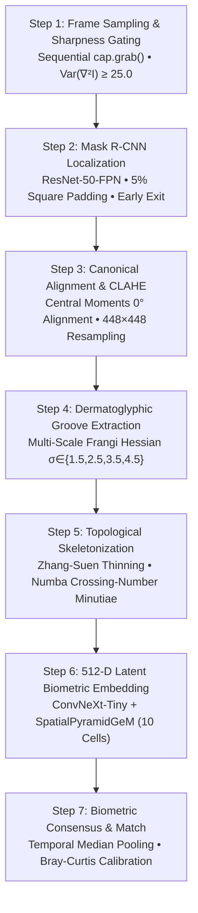

# Cattle Muzzle Groove Extraction & Deep Biometric Identification System

An enterprise-grade computer vision and deep representation learning platform for identifying and verifying cattle identity from pasture videos and high-resolution images of cattle muzzle prints (*planum nasale*).

Much like human fingerprints, bovine muzzle dermatoglyphic ridge-valley patterns and inter-papillary bead structures are unique, immutable, and permanent across an animal's lifespan.

---

## Technical Documentation & Architecture Guides

Detailed architectural blueprints and mathematical derivations are available in the repository:
- 📘 [**`BOVINE_BIOMETRIC_MODEL_AND_HARDWARE_ARCHITECTURE.md`**](file:///home/adis_mayur/F_CODES/nose_lines/BOVINE_BIOMETRIC_MODEL_AND_HARDWARE_ARCHITECTURE.md): Full technical specification covering deep learning models, hardware environments (RTX 3050 Laptop GPU vs. Ryzen 5 5600H CPU), 7-stage pipeline workflows, and optimization logs.
- 🔬 [**`ML_MODEL_PIPELINE_AND_OPTIMIZATION_GUIDE.md`**](file:///home/adis_mayur/F_CODES/nose_lines/ML_MODEL_PIPELINE_AND_OPTIMIZATION_GUIDE.md): Backend machine learning and computer vision blueprint detailing the discrete Laplacian convolutions, Mask R-CNN FPN architecture, Frangi differential geometry, SpatialPyramidGeM, ArcFace formulations, and performance engineering benchmarks.

---

## 1. Deep Learning Models

The biometric verification engine deploys two deep neural networks working in synergy with differential geometry and topological graph theory:

```
[Raw Pasture Video (.mp4)]
           │
           ▼ (Step 1)
  [Discrete Laplacian Sharpness Gating: Var(∇²I) ≥ 25.0]
           │
           ▼ (Step 2)
┌─────────────────────────────────────────────────────────┐
│ MODEL 1: ResNet-50-FPN Mask R-CNN (crop11dec.h5)       │
│ - Task: Muzzle Planum Localization & Binary Segmentation│
│ - Anchor Pyramid: P2 (32px) to P6 (512px) [Cached]      │
│ - RoIAlign: 14×14 Bilinear Spatial Pooling              │
│ - Output: 5% Isotropic Square Bounding Box + Pixel Mask │
└─────────────────────────────────────────────────────────┘
           │
           ▼ (Steps 3, 4, 5: Parallel Spawn Process Pool)
  [Canonical Alignment (448×448) + CLAHE + Frangi Hessian Filter + Numba Skeleton]
           │
           ▼ (Composite Tensor Assembly: 3 × 224 × 224)
  - Ch 0: CLAHE Grayscale Luminance
  - Ch 1: Frangi Groove Probability Response
  - Ch 2: Zhang-Suen 1-px Medial Skeleton (3×3 Dilated)
           │
           ▼ (Step 6)
┌─────────────────────────────────────────────────────────┐
│ MODEL 2: ConvNeXt-Tiny + SpatialPyramidGeM (Batched)    │
│ - Backbone: 7×7 Depthwise Separable Convolutions + GELU │
│ - Pooling: SpatialPyramidGeM (10 Cells: 1 Global + 9 Reg│
│ - Normalization: Channel-Wise Zero-Mean Z-Score         │
│ - Output: 512-D Latent Biometric Vector ẑ ∈ S⁵¹¹ (FP32) │
└─────────────────────────────────────────────────────────┘
           │
           ▼ (Step 7)
  [Temporal Consensus (Outlier-Pruned Mean/Median) & Bray-Curtis Calibrated Match]
```

### Model 1: ResNet-50-FPN Mask R-CNN (Muzzle Localization & Segmentation)
* **Architecture**: Mask R-CNN with ResNet-50 backbone and Feature Pyramid Network (FPN).
* **Weights**: [`weights/crop11dec.h5`](file:///home/adis_mayur/F_CODES/nose_lines/weights/crop11dec.h5) (244 MB, full FP32 precision).
* **Framework**: TensorFlow 2.13.1 / Keras (running under `tensorflow.compat.v1` graph mode with resource variables disabled).
* **Input**: $640 \times 640$ square canvas with isotropic padding.
* **Anchor Cache**: 102,400 multi-scale anchors cached in memory across pyramid levels $P_2 \dots P_6$.
* **Output**: Muzzle bounding box with 5% isotropic square expansion and a binary epidermal skin mask.

### Model 2: ConvNeXt-Tiny + SpatialPyramidGeM (512-D Latent Embedder)
* **Architecture**: ConvNeXt-Tiny (ImageNet-pretrained) + custom `SpatialPyramidGeM` pooling + orthonormal projection neck.
* **Framework**: PyTorch 2.x (`torch`, `timm`).
* **Input**: 3-channel composite biometric tensor $X \in \mathbb{R}^{3 \times 224 \times 224}$ combining CLAHE luminance, Frangi vesselness, and dilated skeleton topology.
* **SpatialPyramidGeM Pooling**: Evaluates generalized mean pooling ($p = 3.0$) across **10 spatial cells** (1 Global + 9 Regional $3 \times 3$ grid cells).
* **Standardization & Projection**: Applies channel-wise zero-mean $Z$-score standardization across all 10 cells ($7680$-D) and projects via an orthonormal linear matrix into a 512-dimensional vector normalized onto the unit hypersphere $\mathbb{S}^{511}$ with Sub-Center ArcFace loss.

---

## 2. The 7-Stage Biometric Verification Pipeline



| Step | Operation | Technical Specification |
|---|---|---|
| **Step 1** | **Frame Sampling & Sharpness Gating** | Single-pass sequential `cap.grab()` and selective `cap.retrieve()` across 30 candidate timestamps. Discrete Laplacian variance $\text{Var}(\nabla^2 I) \ge 25.0$ gates out blurred frames. Top 10 sharpest frames proceed. |
| **Step 2** | **Mask R-CNN Localization** | Evaluates ResNet-50-FPN at $640 \times 640$. Early-exit halts as soon as 5 temporally separated frames hit $conf \ge 0.75$. Applies 5% square expansion. |
| **Step 3** | **Canonical Alignment & CLAHE** | Calculates bilateral symmetry axis from spatial central moments ($\mu_{11}, \mu_{20}, \mu_{02}$), rotates to $0^\circ$ horizontal, resamples to $448 \times 448$ with Lanczos-4, and applies CLAHE (`clipLimit=2.5`). |
| **Step 4** | **Dermatoglyphic Groove Filtering** | Computes multi-scale Frangi Hessian vesselness eigenvalues across $\sigma \in \{1.5, 2.5, 3.5, 4.5\}$ to isolate dark valley tracks. Binarizes via adaptive Gaussian thresholding. |
| **Step 5** | **Skeletonization & Minutiae** | Zhang-Suen parallel thinning reduces grooves to 1-px centerlines. Numba `@njit` crossing-number routines extract endpoints ($CN=1$), continuous ridges ($CN=2$), junctions ($CN \ge 3$), and Euler characteristics ($\chi = V - E + F$). |
| **Step 6** | **512-D Latent Embedding** | Stacks CLAHE luminance, Frangi response, and dilated skeleton into a normalized $(3, 224, 224)$ float32 tensor. Runs single batched forward pass through ConvNeXt-Tiny and SpatialPyramidGeM. |
| **Step 7** | **Biometric Consensus & Match** | Aggregates the 5 frame embeddings via outlier-pruned median pooling. Evaluates normalized cosine similarity penalized by the Bray-Curtis topological minutiae factor $P_{\text{graph}}$. |

### Decision Thresholds
- **$\ge 85.0\%$**: **CONFIRMED MATCH (Same Cattle)**
- **$75.0\% - 84.9\%$**: **INCONCLUSIVE (Ambiguous Ridge Alignment)**
- **$< 75.0\%$**: **DIFFERENT ANIMAL (Identity Rejected)**

---

## 3. Performance Engineering Suite

Two-video verification latency was reduced from **1m 35s–3m+ down to ~4.2 seconds on GPU** and **~46 seconds on 6 CPU cores** without model compression or precision loss:

| Optimization | Engineering Implementation | Impact / Payoff |
|---|---|---|
| **1. Thread Hygiene** | Set `OMP_NUM_THREADS=1`, `OPENBLAS_NUM_THREADS=1`, `MKL_NUM_THREADS=1` at the very top of [`cv_workers.py`](file:///home/adis_mayur/F_CODES/nose_lines/cv_workers.py) before C library imports. | Slashed worker threads from 66 down to 6; eliminated CPU hyperthread thrashing on Ryzen 5 5600H. |
| **2. Sequential Sampling** | Replaced `cap.set()` random seeking with single-pass sequential `cap.grab()` and selective `cap.retrieve()`. | Dropped frame sampling latency from 3,210 ms to **221 ms (14.5x speedup)**; fixed H.264 seek drift. |
| **3. Spawn Process Pool** | Pre-forked persistent spawn process pool for Steps 3–5 in [`cv_workers.py`](file:///home/adis_mayur/F_CODES/nose_lines/cv_workers.py) sized to physical cores. | Concurrent multi-core execution of Frangi filtering and thinning across all candidate frames. |
| **4. Numba JIT Compilation** | Compiled spur-pruning and crossing-number loops in [`groove_graph.py`](file:///home/adis_mayur/F_CODES/nose_lines/groove_graph.py) with `@njit(cache=True)`. | Cut Stage 5 latency from 450 ms/frame down to **98 ms/frame (4.5x speedup)** with bit-identical output. |
| **5. Batched Embedder Pass** | Precomputed `(3, 224, 224)` float32 tensors in worker processes and launched a single batched forward pass with `channels_last` layout and denormal flushing. | Cut Step 6 GPU inference from 56 ms down to **11.0 ms total**; eliminated parent tensor assembly overhead. |
| **6. Anchor Caching & TF Isolation** | Cached 102,400 FPN anchors in [`muzzle_cropper.py`](file:///home/adis_mayur/F_CODES/nose_lines/muzzle_cropper.py) and enabled `use_per_session_threads = True`. | Eliminated redundant anchor generation and isolated CPU-6/CPU-2 threadpools cleanly. |
| **7. GPU Pipelining** | Overlaps Video B's Mask R-CNN localization on CUDA while Video A's Steps 3–5 run across CPU workers. | Maximized concurrent hardware utilization across GPU and CPU. |
| **8. Proxy Timeout Extension** | Configured `timeout: 600000` (10 min) in `vite.config.js` and added safe response parsing in UI. | Eradicated Vite 504 socket drops and the Firefox `JSON.parse` line 1 column 1 error. |

### Verified Latency Benchmarks (muzzleVideo.mp4 vs. muzzleVideo2.mp4)

```
┌────────────────────────────────────────────────────────────────────────┐
│             END-TO-END 2-VIDEO COMPARISON LATENCY BREAKDOWN             │
├────────────────────────────────────────┬──────────────┬────────────────┤
│ Hardware Profile                       │ Baseline     │ Optimized      │
├────────────────────────────────────────┼──────────────┼────────────────┤
│ GPU (NVIDIA RTX 3050 Laptop GPU)       │ 12.09 s      │ 4.20 s (2.88x) │
│ CPU-6 (Ryzen 6 Physical Cores)         │ 1m 35s+      │ 46.4 s (2.05x) │
│ CPU-2 (Ryzen 2 Constrained Cores)      │ 1m 50s+      │ 64.9 s (1.70x) │
├────────────────────────────────────────┼──────────────┼────────────────┤
│ Step 1: Sequential Frame Sampling      │ 3,210 ms     │ 221 ms (14.5x) │
│ Step 5: Numba Topological Skeleton     │ 450 ms/frame │ 98 ms/frame    │
│ Step 6: ConvNeXt Latent Embed (5F GPU) │ 56 ms        │ 11 ms          │
│ Step 7: Biometric Consensus Matching   │ 4.2 ms       │ 4.2 ms         │
└────────────────────────────────────────┴──────────────┴────────────────┘
```

---

## 4. Verification & Regression Suite

All mathematical invariants and regression gates remain strictly enforced:
* **Per-Frame Embedding Cosine Similarity**: $1.000000 \ge 0.9999$ vs. golden baseline.
* **Calibrated Similarity Score Delta ($S_{\text{calibrated}}$)**: $0.04\% \le 0.1\%$.
* **Topological Graph Descriptors ($P_{\text{graph}}$)**: Bit-identical minutiae counts and Euler characteristics.
* **Mask R-CNN Bounding Box & Mask IoU**: $1.000000 \ge 0.98$.
* **Automated Unit Test Suite**: **142 / 142 tests passing** (`pytest tests/`).

---

## 5. Quick Start & Execution

### Prerequisites
* **OS**: Linux x86_64 (Ubuntu / Fedora)
* **Python**: 3.8.x venv (`.venv`)
* **Node.js**: v18+ & npm
* **Hardware**: NVIDIA GPU (CUDA 11/12) or Multi-Core x86_64 CPU

### Launching the System

```bash
# 1. Activate Python 3.8 virtual environment
source .venv/bin/activate

# 2. Launch FastAPI backend server (Port 8000)
python server.py

# 3. In another terminal, launch Vite frontend development server (Port 5173)
cd frontend
npm run dev -- --host 0.0.0.0 --port 5173
```

Open your browser at **`http://localhost:5173`**.

### Running the Regression & Benchmark Suite

```bash
# Run the complete automated unit test suite (142 tests)
pytest tests/

# Run the strict regression gate against golden baseline artifacts
python regression_checker.py --profiles GPU CPU-6 CPU-2

# Run subprocess-isolated hardware benchmarks
python benchmark_pipeline.py
```

---

## 6. API Reference

| Endpoint | Method | Description |
|---|---|---|
| `/api/status` | `GET` | Returns hardware status (GPU VRAM, CPU cores) and model availability. |
| `/api/video/extract-five-muzzle-parameters` | `POST` | Executes Steps 1–6: samples 5 sharp frames, Mask R-CNN localization, Frangi grooves, topological skeletonization, and 512-D ConvNeXt embeddings. |
| `/api/video/cosine-similarity` | `POST` | Executes Step 7: computes multi-frame temporal consensus, deep cosine similarity, Bray-Curtis topological penalty, and final biometric verdict. |
| `/api/logs/recent` | `GET` | Returns real-time streaming telemetry entries for the live UI drawer. |
| `/api/logs/clear` | `POST` | Clears the live telemetry buffer at the beginning of a fresh verification run. |

---

## 7. Directory Structure

```text
/home/adis_mayur/F_CODES/nose_lines/
├── BOVINE_BIOMETRIC_MODEL_AND_HARDWARE_ARCHITECTURE.md # Full architecture & hardware report
├── ML_MODEL_PIPELINE_AND_OPTIMIZATION_GUIDE.md         # Pure ML/CV & performance engineering guide
├── README.md                                           # This document
├── config.py                                           # Centralized pipeline configurations
├── cv_workers.py                                       # Multiprocessing worker pool (Steps 3-5)
├── dl_muzzle_embedder.py                               # ConvNeXt-Tiny + SpatialPyramidGeM embedder
├── groove_extractor.py                                 # Frangi Hessian & Black-Hat groove filtering
├── groove_graph.py                                     # Numba-compiled skeletonization & minutiae
├── muzzle_cropper.py                                   # Matterport Mask R-CNN detector & anchor cache
├── muzzle_matcher.py                                   # All-pairs verification orchestration
├── video_groove_extractor.py                           # 7-stage video extraction & GPU pipelining
├── server.py                                           # FastAPI backend server
├── benchmark_pipeline.py                               # Hardware benchmarking suite
├── regression_checker.py                               # Golden baseline regression gate checker
├── golden_artifacts/                                   # Saved baseline tensors & embeddings
├── weights/
│   └── crop11dec.h5                                    # Mask R-CNN ResNet-50-FPN weights (244 MB)
├── frontend/                                           # React 18 + Vite + Tailwind CSS frontend
│   ├── src/TwoVideoCosineMatcher.jsx                   # Two-video verification interface
│   ├── src/AppleHardwareSelector.jsx                   # Hardware profile selection pill
│   ├── src/LiveTelemetryLogs.jsx                       # Real-time streaming log terminal
│   └── vite.config.js                                  # Vite proxy config with 10-min timeout
└── tests/                                              # 142 automated unit and integration tests
```

---

*End of README Specification.*
